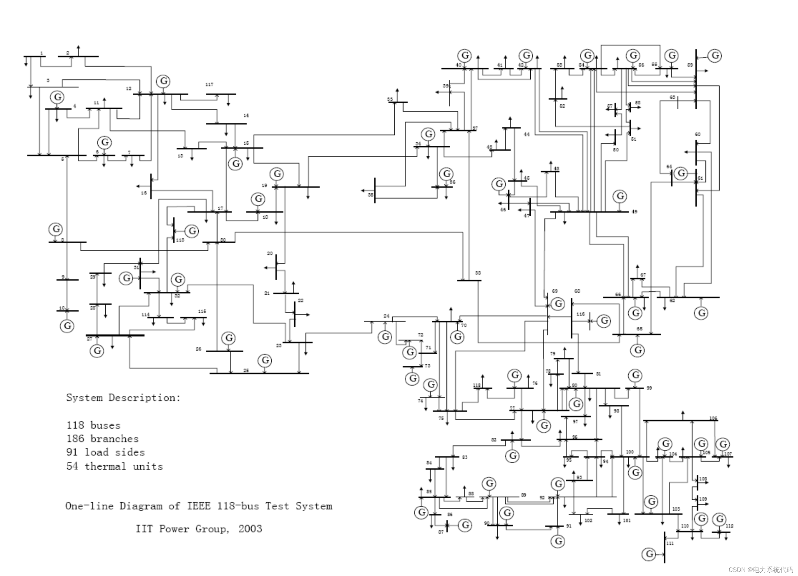
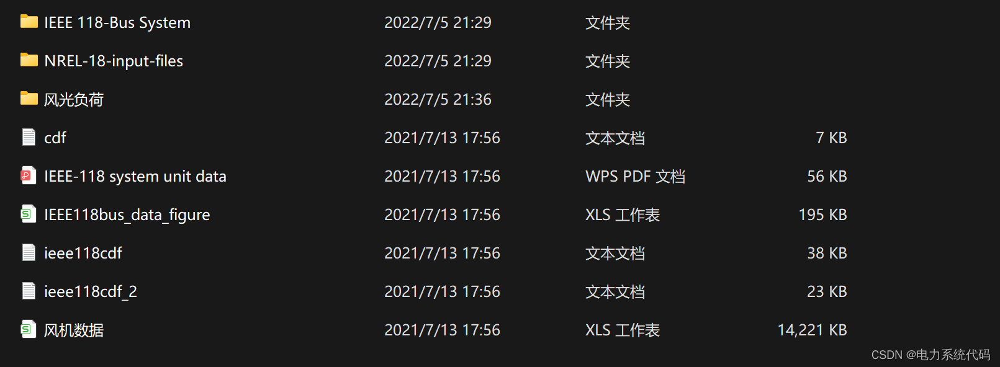
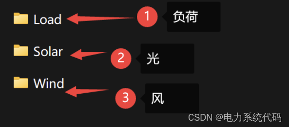
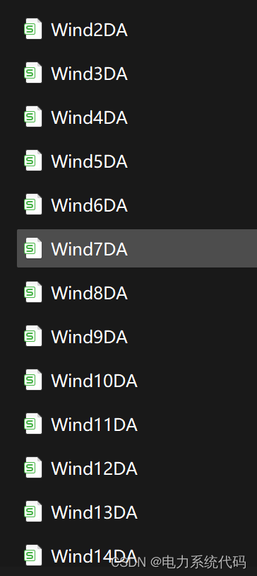
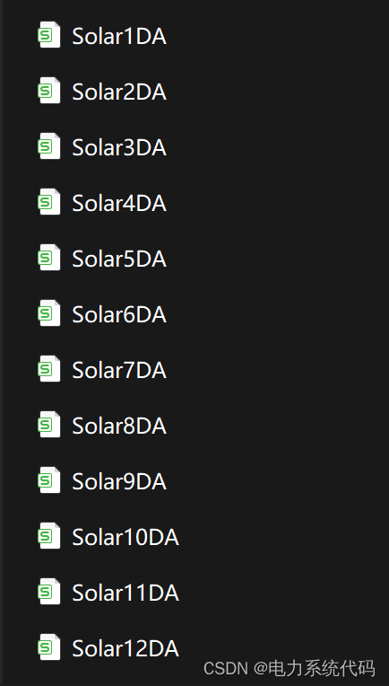
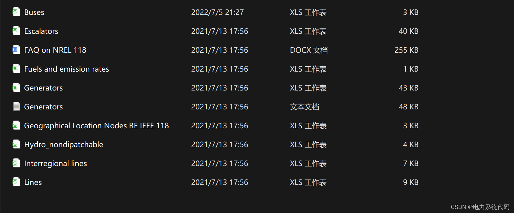
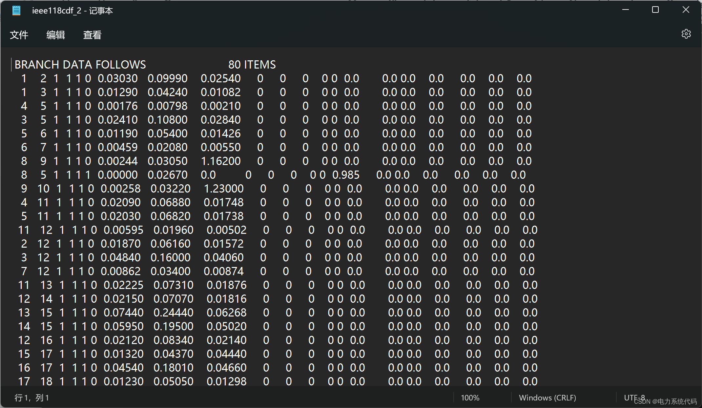
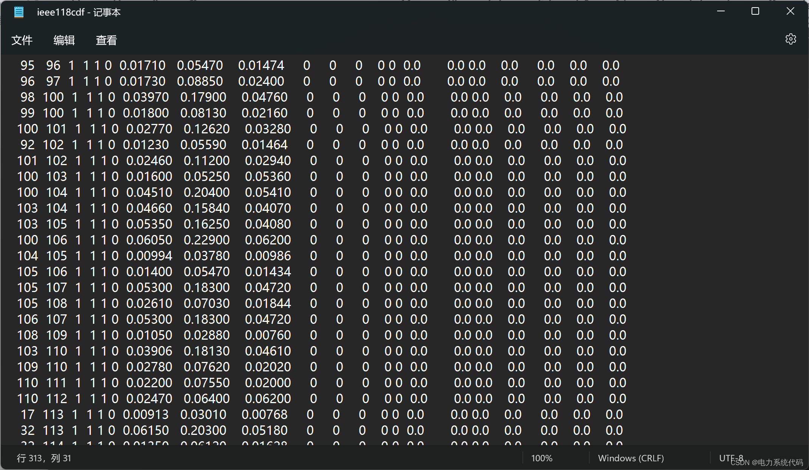
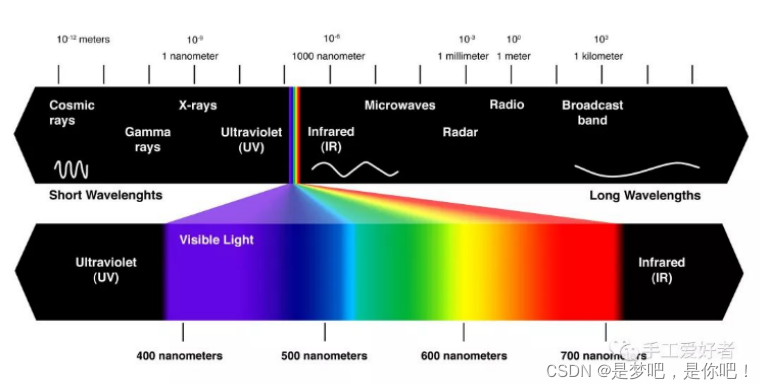
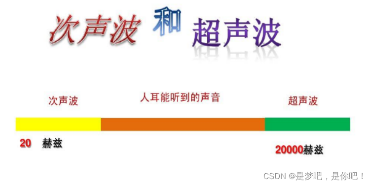

# Electrical Data IEEE118 (including wind and solar energy)

​  
Contents
1. Overview
2. Insights beyond the mainstream
2.1 Visual
2.2 Hearing
Editor
1. Overview
All data and structural diagrams need to be viewed here:
\n        \n  
Editor
Editor
Editor
Editor
Editor
Editor
Other than that, I won't be taking screenshots one by one.
2. Insights beyond the mainstream At that time, studying physics felt like our perception was akin to a vacuum channel; the world before us, filled with all its diversity, was the true objective world. Since listening to Professor Shi Yigong's lecture, my existing understanding has been somewhat overturned. (The first person on the left is Shi Yigong, and the second is Yang Zhening!) )
Editor
2.1 Vision - Taking vision and hearing as examples: Vision accounts for approximately 70% to 80% of human information perception, yet it is merely a functional manifestation of the biophotoreceptor system. Its natural evolution originates from the simplest photosynthetic energy metabolism in lower organisms. Therefore, it can only perceive light waves between 400-700 nanometers within the range of illumination that is limited by an evolutionary environment. In other words, objects that do not emit or reflect light within this range are considered nonexistent to the visual sense.
Editor
Moreover, the world is inherently colorless. The so-called "colors" are merely the result of light waves with wavelengths in the visible spectrum interacting with the visual system's sensory conversion. Mixed light produces white light, and a single wavelength of light can produce different colors if it differs by 5 nanometers. Therefore, within the range of light from 400 to 700 nanometers, approximately 150 different "colors" can be transformed, mainly including red (700-610 nm), orange (610-590 nm), yellow (590-570 nm), green (570-500 nm), blue (500-460 nm), purple (460-440 nm), and violet (440-400 nm). Imagine, if the human eye's structure were initially a spectrophotometer for measuring wavelengths, would there still be colors in the world?
2.2 Sound Similarly, the world is inherently silent. The so-called "sound" is merely mechanical vibrational waves that stimulate the auditory organs due to their "illusion." The mistake lies in this "sound" not reflecting what sound is, but instead leading listeners to mistakenly perceive it as such. Even outside the ears, it is directly an objective auditory experience. The source of this error extends beyond the tympanic membrane, cochlear cells, and auditory nerve centers; even the external ear canal contributes, causing smaller needle frequencies to become much louder. It is said that below 20 Hz subsonic waves are inaudible to the human ear, and above 20,000 Hz ultrasonic waves are also inaudible, leaving us with a narrow range of vibrational wave frequencies we can hear. If the human ear's structure were initially a vibration wavelength detector, would there still be sounds in the world?
Just as we input fundamentally only 0s and 1s into computers, yet they present us with very realistic images. Our senses have a specification, not an objective reflection of the real world. Of course, here I do not deny that there indeed exists an objective external reality. Do you still believe in "seeing is believing"?
Editor

## Images

<!-- PAYMENT_BLOCK -->

## Get this dataset

- Payment link (Stripe): [Buy now](https://buy.stripe.com/3cs8yP7sY87d0vu9AB)
- Payment QR code: 

<!-- /PAYMENT_BLOCK -->
